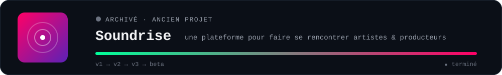
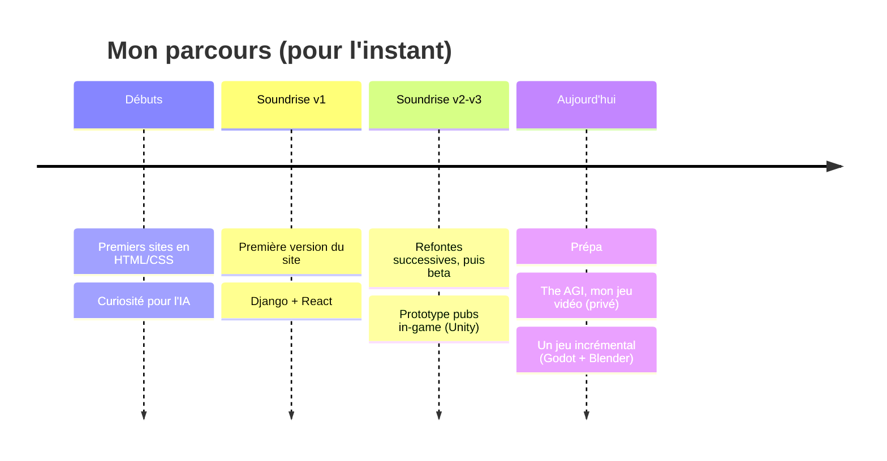

<!-- ═══════════════════════════  HEADER  ═══════════════════════════ -->
<div align="center">



<br/>

<a href="https://www.linkedin.com/in/valentin-lallement-a7096228a/"></a>
<!-- Optionnel : ajoute ton email si tu veux qu'il soit public
<a href="mailto:TON_EMAIL"></a> -->


</div>

<br/>

<!-- ═══════════════════════════  À PROPOS  ═══════════════════════════ -->

```js
const valentin = {
  statut:          "étudiant en prépa (bac+2) 🇫🇷",
  enCours:         ["The AGI — un jeu vidéo 🎮", "un jeu incrémental sous Godot & Blender"],
  dejaFait:        ["Soundrise : mise en relation beatmakers / artistes (vente de beats, messagerie temps réel)", "un proto de pubs in-game sous Unity"],
  jApprends:       ["game dev & game design", "IA dans les jeux (PNJ, comportements)", "les maths de prépa… et à quoi elles servent vraiment"],
  jeVeuxApprendre: ["vision par ordinateur", "deep learning", "IA & simulation (agents, environnements virtuels)"],
  jAime:           ["transformer une idée en quelque chose de concret", "plonger dans un domaine que je ne connais pas", "apprendre en faisant"],
};
```

<br/>

<!-- ═══════════════════════════  PROJETS  ═══════════════════════════ -->

## `> ls ./projets --en-cours`



<sub>Ces deux projets sont dans des repos privés pour l'instant. Ils sortiront de l'ombre quand ils seront prêts.</sub>

<br/>

## `> ls ./projets --archives`

<a href="https://github.com/ValentinLallement/BetaSoundRise">
  
</a>

<table>
<tr>
<td width="50%" valign="top">

### 🎵 Soundrise
Mon premier vrai projet, mené sur plusieurs versions. L'idée : un espace où artistes et producteurs pouvaient se trouver et collaborer, avec de l'IA pour aider à la découverte. Le site n'est plus en ligne ; une partie du code et les anciennes versions restent ici.


`📦 archivé` — [BetaSoundRise](https://github.com/ValentinLallement/BetaSoundRise) · [v1](https://github.com/ValentinLallement/Soundrise) · [v2](https://github.com/ValentinLallement/soundrise2) · [v3](https://github.com/ValentinLallement/soundrise3)

</td>
<td width="50%" valign="top">

### 🕹️ Pubs in-game pour jeux indés
Un prototype pour permettre aux petits studios d'intégrer des emplacements publicitaires dans leurs jeux Unity, et d'en tirer un revenu complémentaire.


`⏸ en pause` — j'y reviendrai quand j'aurai plus de temps.

</td>
</tr>
</table>

<br/>

<!-- ═══════════════════════════  STACK  ═══════════════════════════ -->

## `> cat stack.txt`

<div align="center">

**Ce que j'utilise régulièrement**


**Ce que j'explore / avec quoi j'ai déjà bricolé**


</div>

<br/>

<!-- ═══════════════════════════  PARCOURS  ═══════════════════════════ -->

## `> git log --oneline parcours`



<br/>

<!-- ═══════════════════════════  ACTIVITÉ  ═══════════════════════════ -->

## `> git status`

<div align="center">

<picture>
  <source media="(prefers-color-scheme: dark)" srcset="https://raw.githubusercontent.com/ValentinLallement/ValentinLallement/output/snake-dark.svg" />
  <source media="(prefers-color-scheme: light)" srcset="https://raw.githubusercontent.com/ValentinLallement/ValentinLallement/output/snake-light.svg" />
  
</picture>


</div>

<br/>

<!-- ═══════════════════════════  ROADMAP  ═══════════════════════════ -->

<details>
<summary><b><code>> cat roadmap.md</code></b> — ce sur quoi je veux progresser 👇</summary>

<br/>

- [ ] Sortir une première démo jouable de The AGI
- [ ] Finir le jeu incrémental et le publier
- [ ] Entraîner un premier vrai modèle de ML
- [ ] Écrire de vrais tests et une CI propre


</details>

<br/>

<div align="center">

<sub>Ouvert aux échanges, aux conseils et aux collabs sur des projets autour de l'IA ou des jeux vidéo — n'hésite pas à m'écrire.</sub>


</div>
